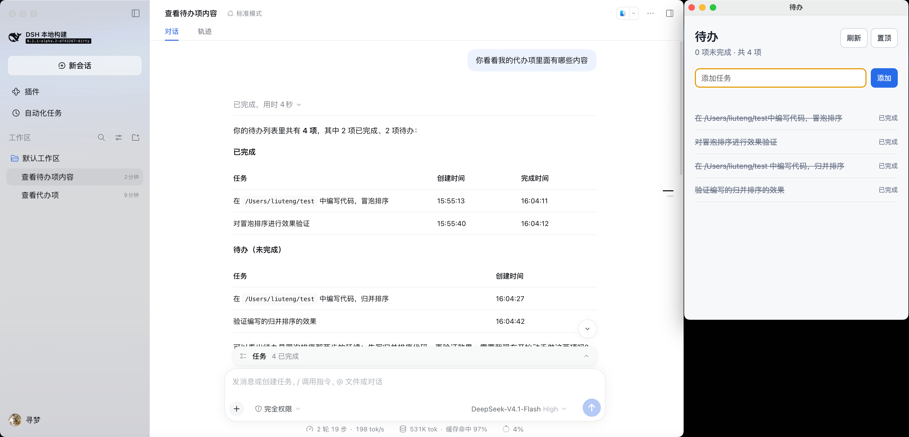
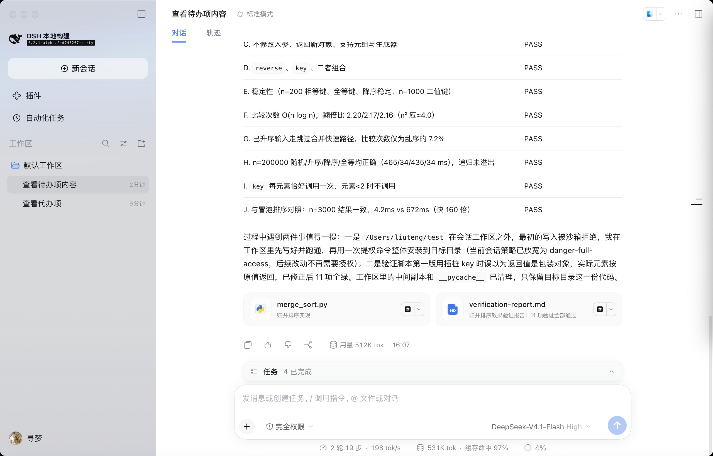
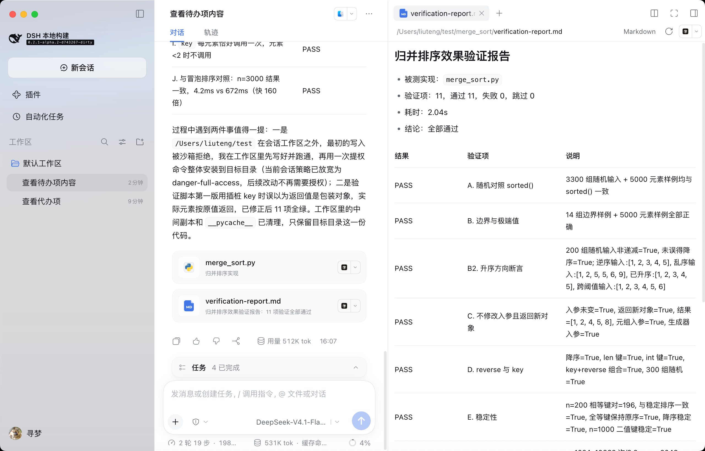

# DeepSeek Harness 桌面待办：实现说明

**整理日期：**2026 年 10 月 16 日  
**实现状态：**必做功能已写入本地源码；自动化测试和构建通过；完整人工验收待完成。  
**项目网页（预计地址）：**[https://xunmenglt.github.io/yaoji/](https://xunmenglt.github.io/yaoji/)  
**网页源码仓库：**[https://github.com/xunmenglt/yaoji](https://github.com/xunmenglt/yaoji)

> 上述网页地址按 GitHub Pages 项目站点规则和当前仓库地址推算。当前文件仅保存在本地；在推送到 GitHub 并启用 Pages 前，不能把该网址视为已上线。

## 1. 任务目标

以指定版本的 DeepSeek Harness 源码为基础，做一个与主窗口分离的桌面待办窗口。窗口必须支持独立打开、关闭重开以及置顶开关；Agent 必须能够查询和完成同一份真实任务数据。任务在窗口关闭以及 Harness 完全退出、重新启动后仍应保留。

题目还要求妥善处理同名任务和重复完成：同名任务使用稳定标识区分；无法仅凭标题确定目标时，Agent 先询问，不修改数据；对已完成任务重复执行时，返回当前状态，不影响其他任务。

本轮源代码位于本地 deepseek-harness 仓库，基于题目指定的提交 d743267388641bc76f17c45ce8b4c231aed1d32c 开发。此说明网页与功能源码是两个仓库：网页只展示报告，不运行待办功能，也不读取本机任务。

## 2. 已完成的工作

| 范围 | 已实现内容 | 对应要求 |
| --- | --- | --- |
| 独立窗口 | 在应用菜单加入“打开待办”，使用 Electron BrowserWindow 创建独立窗口；可拖动、关闭和重新打开 | F17 |
| 窗口置顶 | 提供置顶开关，使用操作系统窗口级置顶能力 | F18 |
| 窗口操作 | 显示标题与完成状态；支持快速添加、按任务 ID 完成、手动刷新和定时刷新 | 支撑必做流程；部分为选做功能 |
| 本地数据 | 将任务写入 DSH_HOME 下的 desktop-tasks.json；任务有稳定 UUID，写入使用文件锁和原子替换 | 本地保存、重启保留 |
| Agent 工具 | desktop_tasks_query 读取任务；desktop_tasks_complete 完成指定任务；两者读取窗口使用的同一文件 | Agent 查询、Agent 完成、数据同步 |
| 同名任务 | 允许同名，保留不同 ID；按标题无法确定对象时返回候选项，不修改任务 | 必做边界情况 |
| 重复完成 | 再次完成同一任务时返回“已完成”，不重复写入，也不影响其他任务 | 必做边界情况 |

### 数据如何流转

待办窗口 → 本地任务文件 ← Agent 工具

窗口创建或完成任务后写入文件；工具查询同一文件并返回当前状态。Agent 完成任务后，窗口通过刷新读取新状态。这里使用的是持久化数据，不依赖固定工具返回值或聊天记忆。

## 3. 目前有哪些验证证据

| 验证项 | 当前结果 |
| --- | --- |
| 完整项目构建 | 通过 |
| 配置校验 | 247 个配置文件通过 |
| 待办工具与桌面启动相关测试 | 163 项通过，无失败 |
| 本机启动 | 修改后的桌面端能够启动，Host 进入运行状态 |
| 可见界面 | 早期截图显示“打开待办”菜单项和两项未完成任务；新增截图显示 Agent 对话与独立窗口并列 |

自动化测试包括同名任务不误改、按 ID 完成指定任务、重复完成不改写文件、并发新增、新工具上下文读取相同任务等情况。上述结果说明代码路径可运行，但不能代替完整的人机操作验收。

### 用户提供的本机截图

以下图片使用相对路径。从 yaoji 仓库根目录转换这份 Markdown 为 PDF 时，请让转换工具同时读取 assets 目录。

**图 1：Agent 对话与待办窗口。**截图里 Agent 回复列出 4 项任务，称其中 2 项已完成、2 项待办；右侧窗口显示 0 项未完成、共 4 项。两处计数不同，需要按操作时间线核对，不能据此宣称状态一致性已验收。

**图 2：Agent 执行归并排序任务。**这是产品运行的附加演示，不属于桌面待办的验收证据。

**图 3：Markdown 验证报告预览。**该报告对应归并排序任务，与本说明的待办功能不同。

## 4. 还没有完成什么，如何取舍

### 4.1 必做流程中仍需人工验收的部分

- 在新的真实 Agent 对话中调用查询、完成工具，并核对回答与窗口一致。
- 置顶后最小化主窗口、切换到其他普通应用，确认待办仍可见且可操作；取消置顶后确认可被其他窗口覆盖。
- 关闭并重开待办窗口；完全退出 Harness 及相关进程后再次从修改后的源码启动，核对窗口和 Agent 查询结果。

这些步骤涉及真实模型、操作系统窗口层级及完整进程生命周期。当前实现和单元、集成测试已覆盖相应逻辑，但本报告把它们如实标为“待人工验收”。

### 4.2 本轮暂缓的选做功能

编辑、删除、搜索与筛选、优先级、截止日期、导入导出、“全部 / 今日”、Agent 新建任务，以及 Agent 查询时按状态筛选，均没有纳入这轮最小交付。它们会扩大 UI、数据结构和规则范围；先确保题目明确要求的独立窗口、共享数据和边界行为可复现。窗口内快速添加、完成虽然属于选做，本轮已经实现，因为它们能让必做演示流程直接运行。

## 5. 如果再给一小时，先补哪块

| 时间 | 优先事项 | 完成标准 |
| --- | --- | --- |
| 00—15 分 | 在新对话中让 Agent 查询两项任务，按 ID 完成其中一项 | 查询和窗口状态一致，另一项仍未完成 |
| 15—30 分 | 验证同名任务与重复完成 | 标题歧义不误改；指定 ID 后只改目标；重复完成无额外修改 |
| 30—45 分 | 验证置顶、跨应用、关窗重开及完全退出后重启 | F17 / F18 和持久化流程按题目要求运行 |
| 45—60 分 | 修复发现的阻断问题，并保存脱敏证据 | 更新测试或文档，形成可复现的验收记录 |

**第一优先级是必做流程的端到端验收与修复。**只有这些步骤稳定通过，才考虑增加新的选做功能。

## 6. 本机验收清单

1. 从修改后的源码启动桌面端，在 macOS 应用菜单点击“打开待办”。
2. 在独立窗口中创建两项任务，确认两项均为未完成。
3. 新建 Agent 对话，调用 desktop_tasks_query，核对标题、ID 和状态。
4. 调用 desktop_tasks_complete 完成其中一项，刷新窗口，确认另一项保持未完成。
5. 开启置顶，最小化 Harness 主窗口并切换到其他应用；再取消置顶。
6. 关闭并重开待办窗口；完全退出 Harness 后重新启动，再核对任务与工具结果。
7. 分别检查同名标题的歧义处理和已完成任务的重复调用结果。

验收前后应使用同一个 DSH_HOME，否则会读取不同的数据文件。

## 7. 网页发布说明

本说明页对应的 HTML 文件是 yaoji 仓库根目录的 index.html。将本仓库提交并推送到 GitHub 后，在仓库 Settings → Pages 中选择 Deploy from a branch、main、/ (root)，即可使用预计地址：

**[https://xunmenglt.github.io/yaoji/](https://xunmenglt.github.io/yaoji/)**

如配置了自定义域名，以 GitHub Pages 设置页显示的实际发布地址为准。本页和 Markdown 已按要求加入原始截图，其中可见本机路径、账号昵称等信息；在公开推送前，请确认这些内容可以展示。首页顶部的示意界面仍是脱敏绘制。
